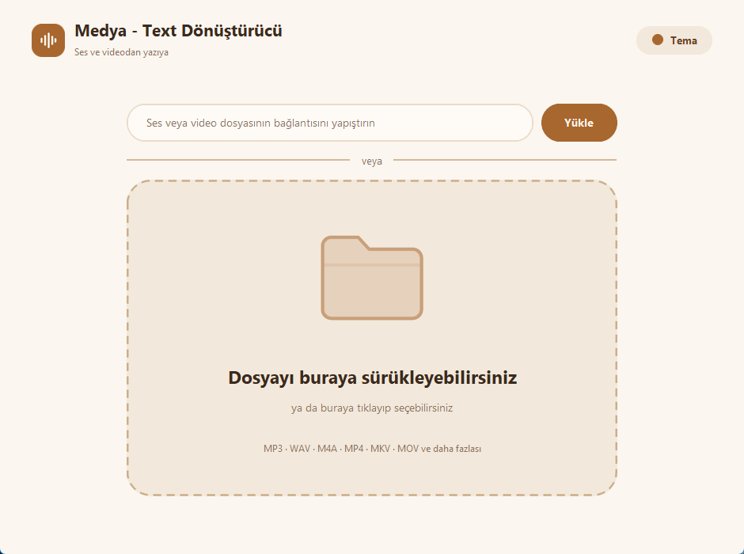
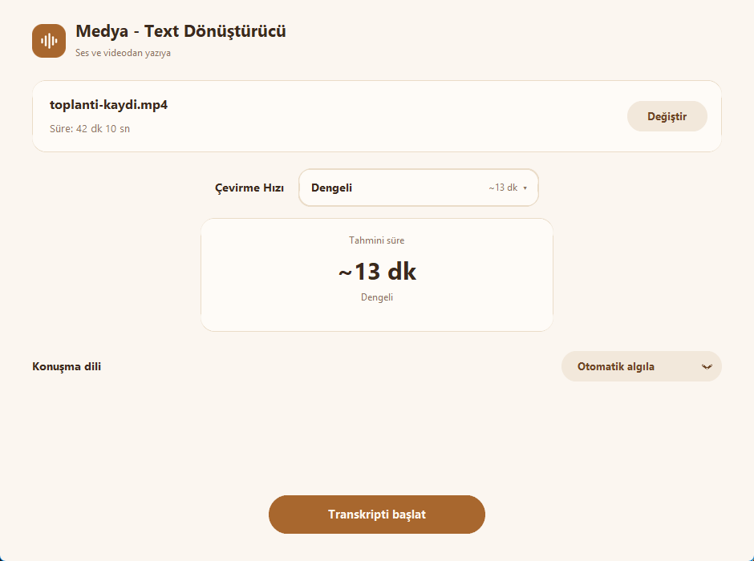
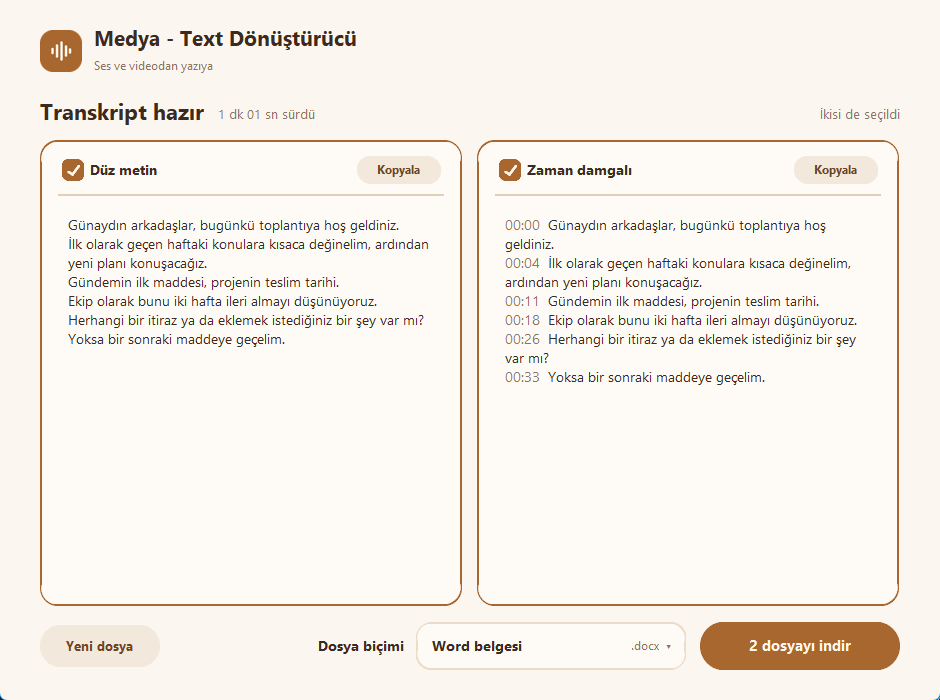
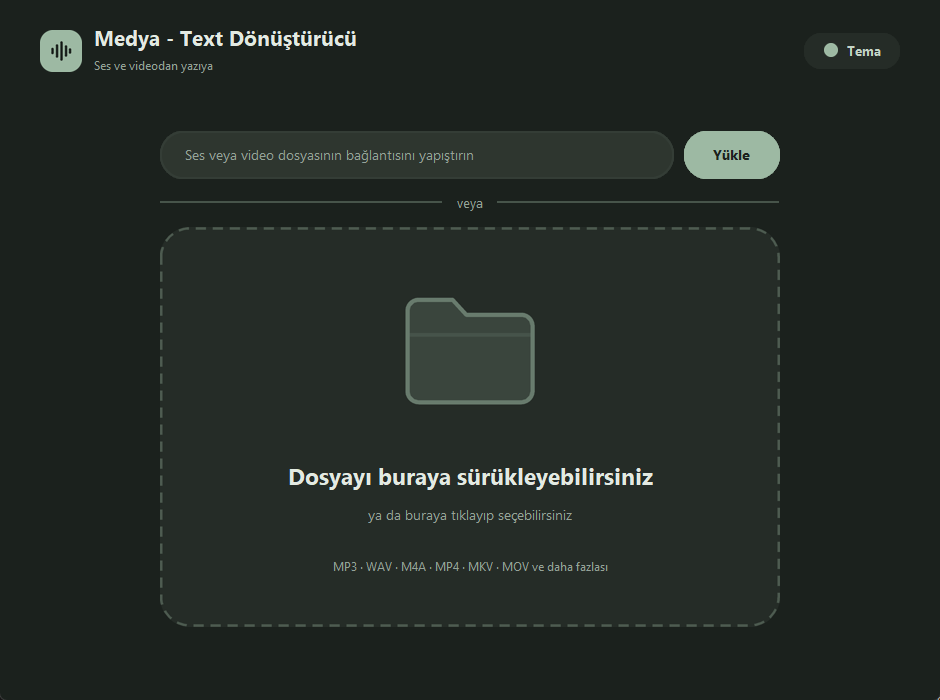
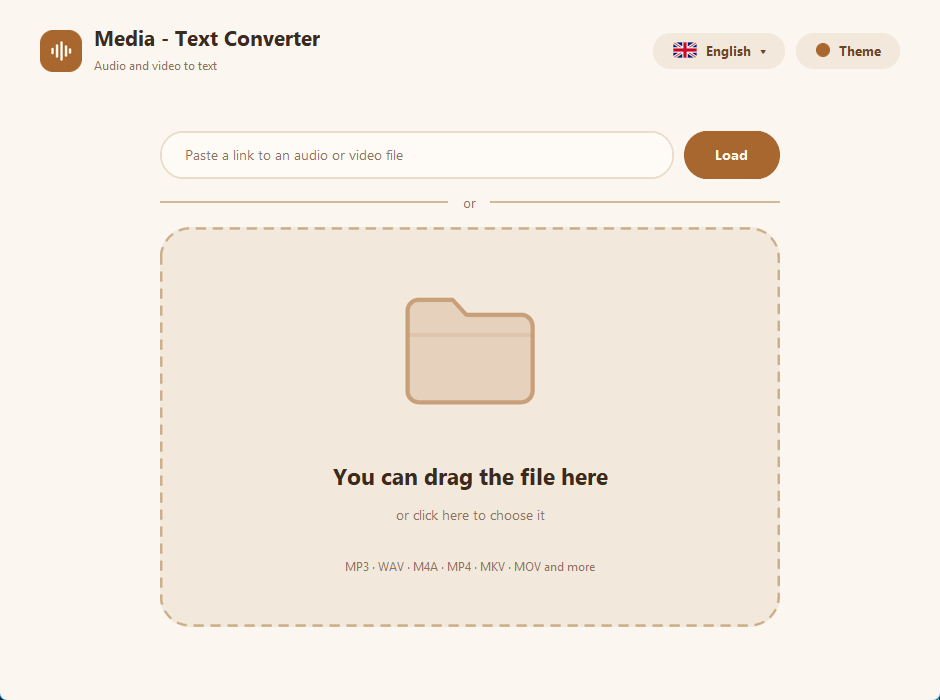

# Medya - Text Dönüştürücü

Ses ve video dosyalarını **yazıya çeviren**, internete bağlanmadan çalışan bir Windows programı.
Dosyanızı sürükleyin, hızı seçin, metni Word, PDF, metin dosyası ya da altyazı olarak indirin.



## Özellikler

- **Çevrimdışı çalışır.** Ses ve videolarınız bilgisayarınızdan dışarı çıkmaz. Yalnızca ilk kullanımda gerekli dosyalar bir kere indirilir.
- **Çoğu biçimi açar:** MP3, WAV, M4A, AAC, OGG, FLAC, MP4, MKV, MOV, AVI, WEBM ve daha fazlası.
- **Çevirme hızı seçilir:** Otomatik, Hızlı, Dengeli, Güvenli. Her seçeneğin yanında dosyaya göre tahmini süre görünür, çeviri sırasında yüzde ve kalan süre gösterilir.
- **İki metin biçimi:** düz metin ve zaman damgalı metin. İkisini birden de indirebilirsiniz.
- **Dört dosya biçimi:** Word (`.docx`), PDF, metin (`.txt`) ve altyazı (`.srt`).
- **Doğrudan dosya bağlantısı** yapıştırarak çeviri (örneğin `.mp3` ya da `.mp4` ile biten adresler).
- **Yedi renk, açık / koyu / otomatik tema:** Yumuşak, Karamel, Bal, Adaçayı, Okyanus, Nergis, Lavanta.
- Konuşma dili otomatik algılanır ya da elle seçilir (Türkçe dahil 17 dil).
- **Türkçe ve İngilizce arayüz:** Ana ekranın sağ üstündeki dil butonuyla (bayraklı) değiştirilir. Varsayılan Türkçe'dir.

| Seçenekler | Sonuç |
|---|---|
|  |  |



## Kurulum (kullanıcılar için)

1. [Releases](../../releases) sayfasından **`MedyaTextKurulum.exe`** dosyasını indirin.
2. Çift tıklayıp "İleri" diyerek kurun. Yönetici izni gerekmez, program kullanıcı klasörünüze kurulur.
3. Başlat menüsünden ya da masaüstü kısayolundan açın.

**Windows uyarısı:** Program imzalı olmadığı için ilk açılışta mavi bir "Windows bilgisayarınızı korudu" ekranı
çıkabilir. "Ek bilgi" → "Yine de çalıştır" deyin. Bazı antivirüs programları yeni ve imzasız programlara yanlış
alarm verebilir.

**Gereksinimler:** 64 bit Windows 10 veya 11. İlk kullanımda seçilen hıza göre ek dosyalar indirilir:

| Hız | İndirme | Not |
|---|---|---|
| Hızlı | yaklaşık 500 MB | günlük kayıtlar için yeterli |
| Dengeli | yaklaşık 1,6 GB | hız ve doğruluk bir arada |
| Güvenli | yaklaşık 3 GB | en yüksek doğruluk, en yavaşı |

Bu dosyalar kullanıcı klasöründe saklanır ve bir daha indirilmez. Güvenli hız için en az 4 GB boş yer önerilir.
Program yalnızca işlemciyi kullanır (ekran kartı gerekmez).

## Sınırlar

- Aynı anda **tek dosya** çevrilir.
- Bağlantı özelliği yalnızca **doğrudan ses/video dosyası bağlantılarını** destekler. YouTube gibi video sitelerinin
  sayfa bağlantıları, Google Drive paylaşım bağlantıları desteklenmez.
- Çeviri süresi bilgisayarınızın hızına bağlıdır. Tahmini süreler ilk çeviriden sonra kendi bilgisayarınıza göre düzelir.
- Yalnızca Windows için hazırlandı. Android/web sürümü şimdilik yok.

## Kaynaktan çalıştırma ve derleme

Python 3.13 (64 bit) gerekir.

```powershell
git clone https://github.com/mhmtkochan/medya-text-donusturucu.git C:\mt
cd C:\mt
py -3.13 -m venv venv
.\venv\Scripts\python.exe -m pip install -r requirements.txt
.\venv\Scripts\python.exe app.py
```

`.exe` ve kurulum dosyasını üretmek için (kurulum dosyası için [Inno Setup 6](https://jrsoftware.org/isinfo.php) gerekir):

```powershell
.\build.ps1
```

> **Klasör yolunu kısa tutun** (örneğin `C:\mt`). Uzun yollarda `onnxruntime` "Dosya adı çok uzun" hatası verir.

Pencere açmadan hızlı bir deneme için: `MedyaText.exe --selftest ses.wav sonuc.txt`
(çeviriyi ve Word/PDF yazmayı dener, sonucu dosyaya yazar).

## Dosyalar

| Dosya | Ne işe yarar |
|---|---|
| `app.py` | Programın tamamı (arayüz, çeviri, dosya çıktıları) |
| `build.ps1` | `.exe` ve kurulum dosyasını derleyen betik |
| `kurulum.iss` | Inno Setup kurulum betiği |
| `app.ico` | Program simgesi |

## Lisans

Bu projenin kodu [MIT lisansı](LICENSE) ile yayınlanmıştır.
Kullanılan açık kaynak bileşenler ve lisansları için [THIRD_PARTY_NOTICES.md](THIRD_PARTY_NOTICES.md) dosyasına bakın.
Kurulum dosyası, GPL lisanslı bileşenler (FFmpeg içindeki x264 ve x265) içerir; ayrıntılar orada.

---

## English

**Media - Text Converter** (Turkish name: *Medya - Text Dönüştürücü*) is a Windows program that turns audio and
video files into text, **fully offline**. Drag a file in, pick a speed, and download the transcript as Word, PDF,
plain text or subtitles.



- The interface is available in **Turkish and English**. Use the language button (with a flag) at the top right of
  the main screen. Turkish is the default.
- Download `MedyaTextKurulum.exe` from [Releases](../../releases) and run it. No administrator rights are needed.
  Requires 64-bit Windows 10 or 11.
- On first use, extra files (about 500 MB to 3 GB depending on the chosen speed) are downloaded once. After that
  the program works offline.
- Limits: one file at a time; links must point directly to an audio or video file (page links from video sites are
  not supported); Windows only.
- Windows may show a "Windows protected your PC" warning because the program is unsigned. Click "More info", then
  "Run anyway".
- The source code is MIT licensed. The installer includes GPL-licensed components (x264 and x265 inside FFmpeg),
  see [THIRD_PARTY_NOTICES.md](THIRD_PARTY_NOTICES.md).
