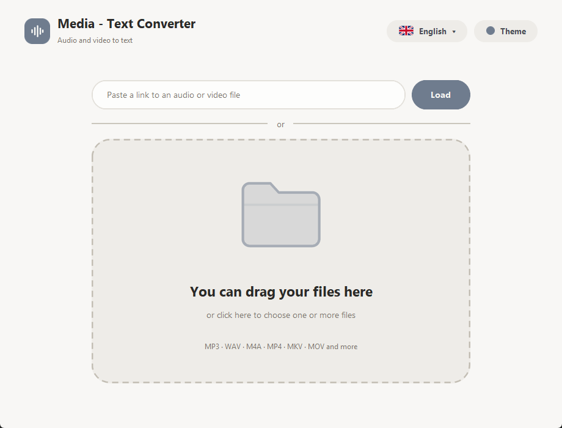
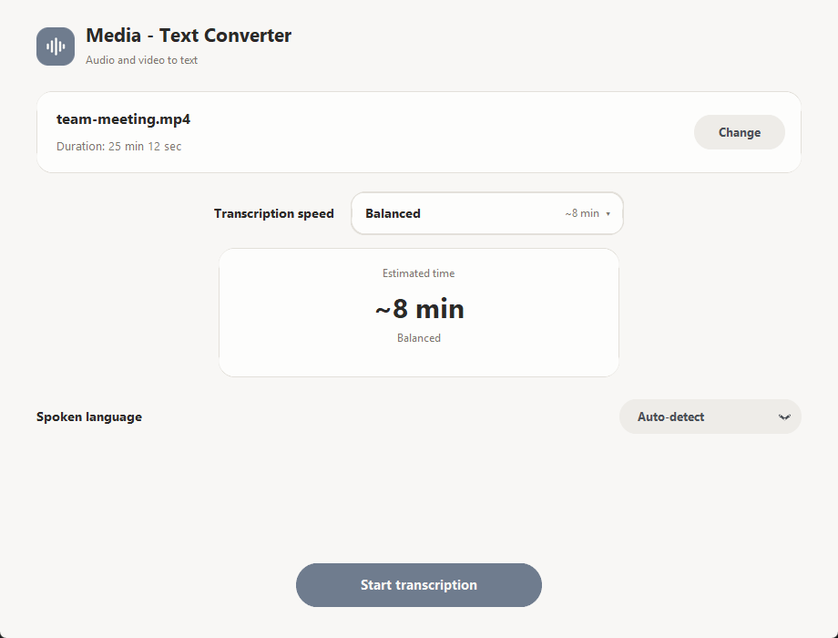
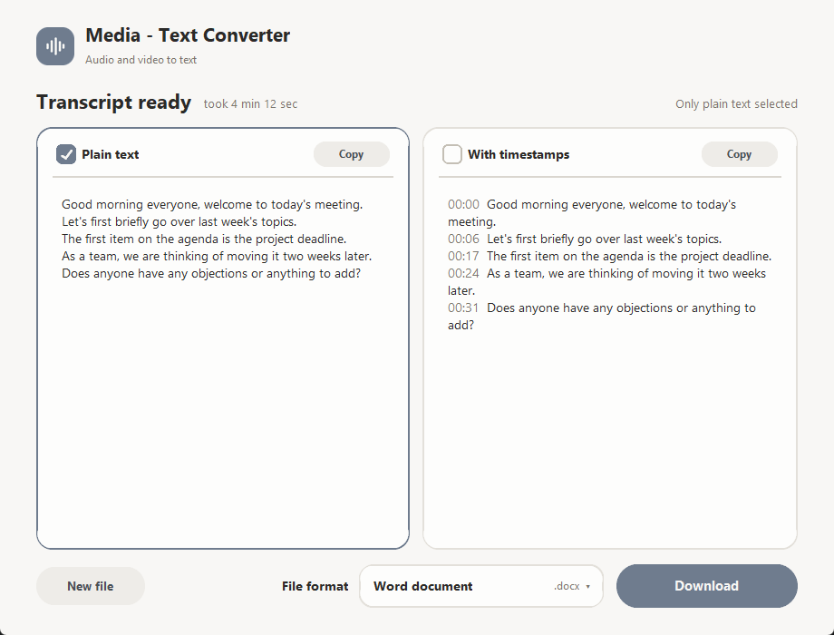
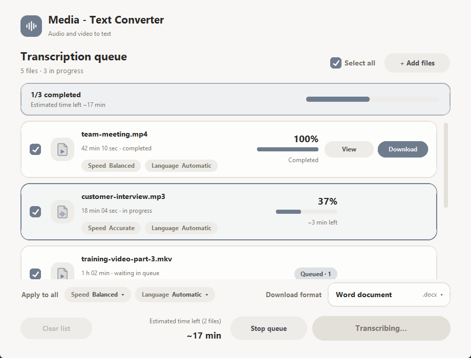
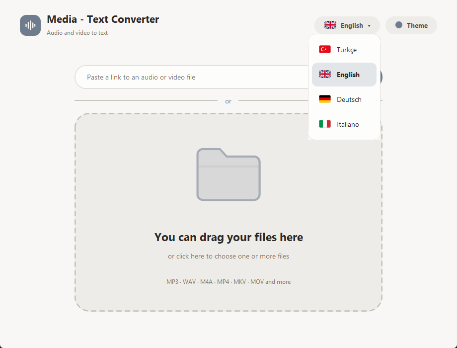
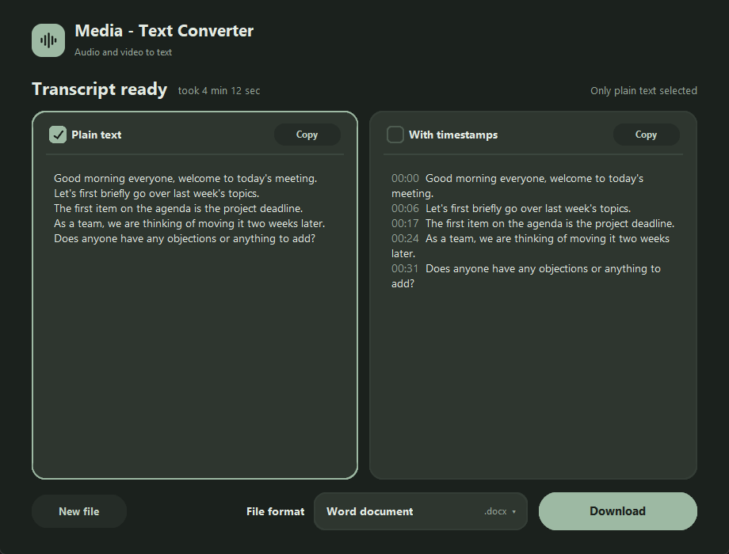

# Media - Text Converter

**English** · [Türkçe](README.tr.md)

A Windows program that turns audio and video files into text, **fully offline**. Drag your files in, pick a speed,
and download the transcript as Word, PDF, plain text or subtitles. (Turkish name: *Medya - Text Dönüştürücü*.)



## Features

- **Works offline.** Your recordings never leave your computer. Only the speech models are downloaded, once, on first use.
- **Opens most formats:** MP3, WAV, M4A, AAC, OGG, FLAC, MP4, MKV, MOV, AVI, WEBM and more.
- **Several files at once (queue):** choose or drag in up to 30 files. They are transcribed one after another, each
  with its own speed and spoken language. The first transcript opens as soon as it is ready, and you can read and
  download it while the rest keep running in the background.
- **Pick the speed:** Automatic, Fast, Balanced or Accurate. Each option shows an estimate for your file, and while
  it runs you see the percentage and the time left. Estimates adjust to your own computer after the first run.
- **Two kinds of text:** plain text and text with timestamps. You can download both at once.
- **Four file formats:** Word (`.docx`), PDF, text (`.txt`) and subtitles (`.srt`).
- **Direct file links:** paste a link ending in `.mp3`, `.mp4` and so on instead of choosing a file.
- **Spoken language** is detected automatically or chosen by hand (17 languages, including Turkish, English, German
  and Italian).
- **Interface in four languages:** Turkish, English, German and Italian. Switch with the flag button at the top right
  of the home screen. Turkish is the default.
- **Seven colours, light, dark or automatic theme:** Soft, Caramel, Honey, Sage, Ocean, Daffodil, Lavender.
- **New version notice:** on startup the program checks GitHub for a newer release and shows a small banner with a
  download button. Nothing is installed automatically. To turn this off, add `"update_check": false` to
  `%APPDATA%\MedyaTextDonusturucu\config.json`.

| Options | Result |
|---|---|
|  |  |



| Language menu | Dark theme |
|---|---|
|  |  |

## Installation (for users)

1. Download **`MedyaTextKurulum.exe`** from the [Releases](../../releases) page.
2. Double-click it and click "Next". No administrator rights are needed; the program is installed in your user folder.
3. Start it from the Start menu or the desktop shortcut.

**Windows warning:** the program is not code-signed, so a blue "Windows protected your PC" screen may appear on the
first launch. Click "More info", then "Run anyway". Some antivirus programs may also raise a false alarm for new,
unsigned programs.

**Requirements:** 64-bit Windows 10 or 11. On first use, extra files are downloaded depending on the speed you choose:

| Speed | Download | Note |
|---|---|---|
| Fast | about 500 MB | enough for everyday recordings |
| Balanced | about 1.6 GB | speed and accuracy together |
| Accurate | about 3 GB | highest accuracy, slowest |

These files are stored in your user folder and are never downloaded again. At least 4 GB of free space is recommended
for the Accurate speed. The program uses the processor only (no graphics card needed).

## Limits

- The queue holds up to **30 files** and processes them **one at a time**, in order.
- Links work only for **direct audio/video file links**. Page links from video sites and Google Drive share links
  are not supported.
- Transcription time depends on your computer. The estimates adjust to your machine after the first run.
- Windows only for now. There is no Android or web version yet.
- If a file has no audio track or is damaged, it is marked "Unreadable" in the queue and skipped.

## Running from source and building

Python 3.13 (64-bit) is required.

```powershell
git clone https://github.com/mhmtkochan/medya-text-donusturucu.git C:\mt
cd C:\mt
py -3.13 -m venv venv
.\venv\Scripts\python.exe -m pip install -r requirements.txt
.\venv\Scripts\python.exe app.py
```

To build the `.exe` and the installer ([Inno Setup 6](https://jrsoftware.org/isinfo.php) is needed for the installer):

```powershell
.\build.ps1
```

> **Keep the folder path short** (for example `C:\mt`). With long paths `onnxruntime` fails with "File name too long".

For a quick check without opening a window: `MedyaText.exe --selftest sound.wav result.txt`
(it transcribes the file, tries the Word/PDF writers and writes the result to a text file).

## Files

| File | What it is for |
|---|---|
| `app.py` | The whole program (interface, transcription, file output) |
| `build.ps1` | Script that builds the `.exe` and the installer (`-ExeOnly` builds only the `.exe`) |
| `kurulum.iss` | Inno Setup installer script (Turkish and English installer) |
| `app.ico` | Program icon |

## License

The code of this project is released under the [MIT license](LICENSE). The open-source components used and their
licenses are listed in [THIRD_PARTY_NOTICES.md](THIRD_PARTY_NOTICES.md).
The installer contains GPL-licensed components (x264 and x265 inside FFmpeg); details are in that file.
