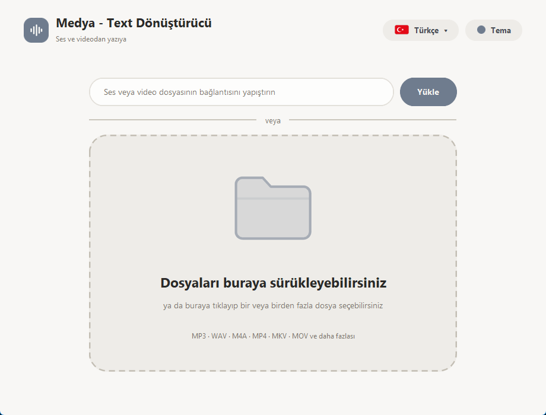
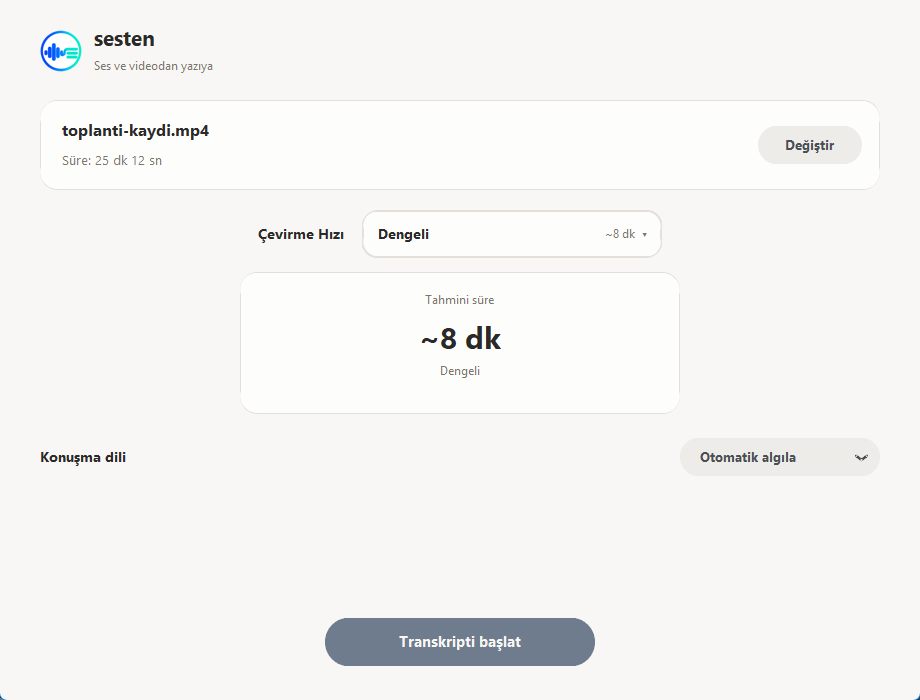
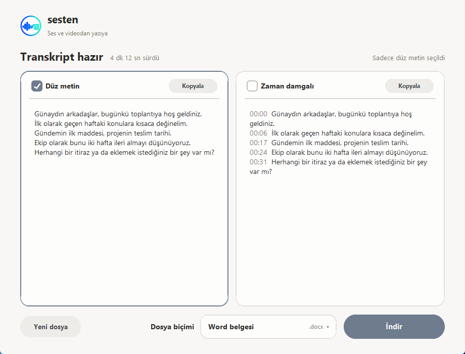
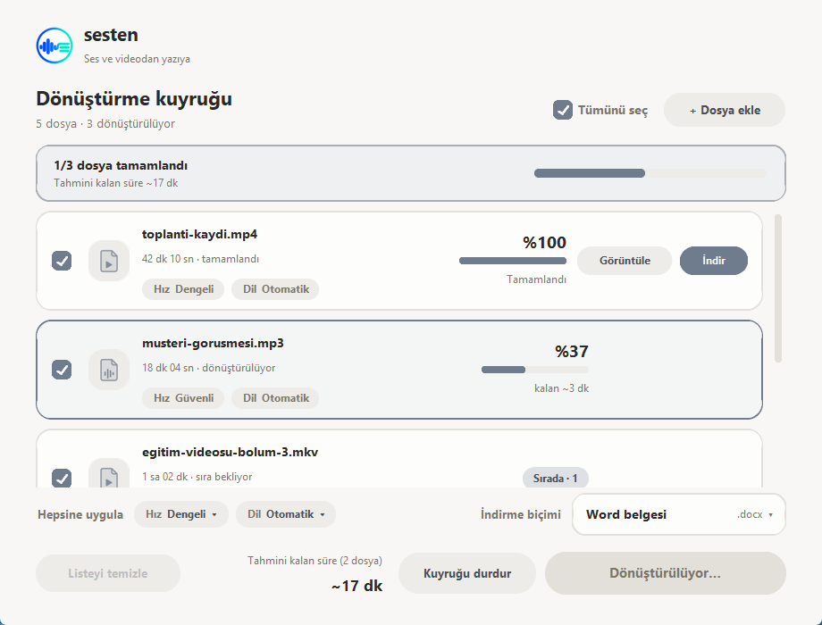
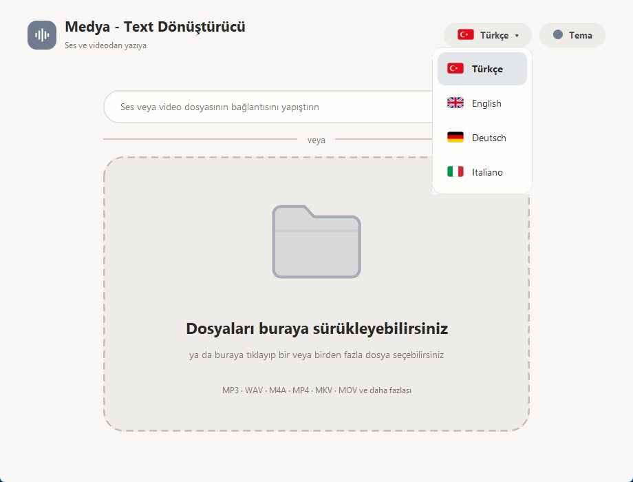
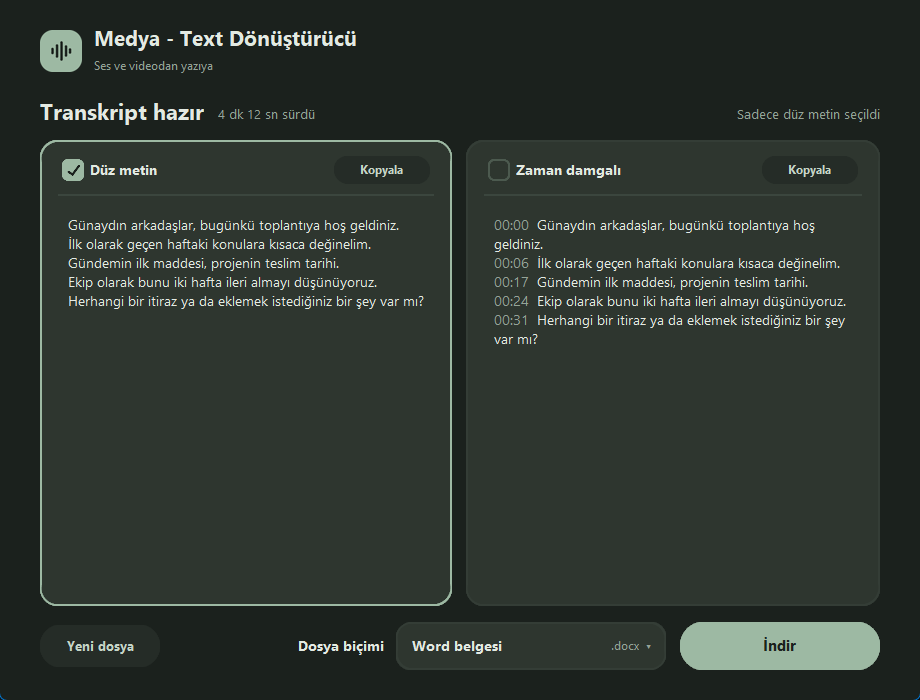

# sesten

[English](README.md) · **Türkçe**

Ses ve video dosyalarını **yazıya çeviren**, internete bağlanmadan çalışan bir Windows programı.
Dosyalarınızı sürükleyin, hızı seçin, metni Word, PDF, metin dosyası ya da altyazı olarak indirin.



## Özellikler

- **Çevrimdışı çalışır.** Ses ve videolarınız bilgisayarınızdan dışarı çıkmaz. Yalnızca ilk kullanımda konuşma
  modelleri bir kere indirilir.
- **Çoğu biçimi açar:** MP3, WAV, M4A, AAC, OGG, FLAC, MP4, MKV, MOV, AVI, WEBM ve daha fazlası.
- **Birden fazla dosya (kuyruk):** En fazla 30 dosyayı birlikte seçin ya da sürükleyin. Dosyalar sırayla çevrilir ve
  her dosya için hız ile konuşma dili ayrı seçilebilir. İlk transkript hazır olur olmaz açılır; diğerleri arka planda
  sürerken onu okuyup indirebilirsiniz.
- **Çevirme hızı seçilir:** Otomatik, Hızlı, Dengeli, Güvenli. Her seçeneğin yanında dosyaya göre tahmini süre
  görünür, çeviri sırasında yüzde ve kalan süre gösterilir. Tahminler ilk çeviriden sonra kendi bilgisayarınıza göre
  düzelir.
- **İki metin biçimi:** düz metin ve zaman damgalı metin. İkisini birden de indirebilirsiniz.
- **Dört dosya biçimi:** Word (`.docx`), PDF, metin (`.txt`) ve altyazı (`.srt`).
- **Doğrudan dosya bağlantısı** yapıştırarak çeviri (örneğin `.mp3` ya da `.mp4` ile biten adresler).
- **Konuşma dili** otomatik algılanır ya da elle seçilir (Türkçe, İngilizce, Almanca ve İtalyanca dahil 17 dil).
- **Dört dilli arayüz:** Türkçe, İngilizce, Almanca ve İtalyanca. Ana ekranın sağ üstündeki dil butonuyla (bayraklı)
  değiştirilir. Varsayılan Türkçe'dir.
- **Yedi renk, açık / koyu / otomatik tema:** Yumuşak, Karamel, Bal, Adaçayı, Okyanus, Nergis, Lavanta.
- **Yeni sürüm bildirimi:** Program açılışta GitHub'daki son sürüme bakar; daha yeni bir sürüm varsa ana ekranda
  "İndir" düğmeli küçük bir şerit çıkar. Kendiliğinden güncellenmez. Kapatmak için
  `%APPDATA%\sesten\config.json` dosyasına `"update_check": false` ekleyin.

| Seçenekler | Sonuç |
|---|---|
|  |  |



| Dil menüsü | Koyu tema |
|---|---|
|  |  |

## Kurulum (kullanıcılar için)

1. [Releases](../../releases) sayfasından **`sesten-setup.exe`** dosyasını indirin.
2. Çift tıklayıp "İleri" diyerek kurun. Yönetici izni gerekmez, program kullanıcı klasörünüze kurulur.
3. Başlat menüsünden ya da masaüstü kısayolundan açın.

**Windows uyarısı:** Program imzalı olmadığı için ilk açılışta mavi bir "Windows bilgisayarınızı korudu" ekranı
çıkabilir. "Ek bilgi" → "Yine de çalıştır" deyin. Bazı antivirüs programları yeni ve imzasız programlara yanlış
alarm verebilir.

**Gereksinimler:** 64 bit Windows 10 veya 11. İlk kullanımda seçilen hıza göre ek dosyalar indirilir:

| Hız | İndirme | Not |
|---|---|---|
| Hızlı | yaklaşık 500 MB | günlük kayıtlar için yeterli |
| Dengeli | yaklaşık 1,6 GB | hız ve doğruluk bir arada |
| Güvenli | yaklaşık 3 GB | en yüksek doğruluk, en yavaşı |

Bu dosyalar kullanıcı klasöründe saklanır ve bir daha indirilmez. Güvenli hız için en az 4 GB boş yer önerilir.
Program yalnızca işlemciyi kullanır (ekran kartı gerekmez).

## Sınırlar

- Kuyrukta en fazla **30 dosya** bulunur ve dosyalar **sırayla** çevrilir (aynı anda tek dosya işlenir).
- Bağlantı özelliği yalnızca **doğrudan ses/video dosyası bağlantılarını** destekler. YouTube gibi video sitelerinin
  sayfa bağlantıları, Google Drive paylaşım bağlantıları desteklenmez.
- Çeviri süresi bilgisayarınızın hızına bağlıdır. Tahmini süreler ilk çeviriden sonra kendi bilgisayarınıza göre düzelir.
- Şimdilik yalnızca Windows için hazırlandı. Android/web sürümü yok.
- Ses kanalı olmayan ya da bozuk bir dosya kuyrukta "Okunamadı" olarak işaretlenir ve atlanır.

## Kaynaktan çalıştırma ve derleme

Python 3.13 (64 bit) gerekir.

```powershell
git clone https://github.com/mhmtkochan/sesten.git C:\mt
cd C:\mt
py -3.13 -m venv venv
.\venv\Scripts\python.exe -m pip install -r requirements.txt
.\venv\Scripts\python.exe app.py
```

`.exe` ve kurulum dosyasını üretmek için (kurulum dosyası için [Inno Setup 6](https://jrsoftware.org/isinfo.php) gerekir):

```powershell
.\build.ps1
```

> **Klasör yolunu kısa tutun** (örneğin `C:\mt`). Uzun yollarda `onnxruntime` "Dosya adı çok uzun" hatası verir.

Pencere açmadan hızlı bir deneme için: `sesten.exe --selftest ses.wav sonuc.txt`
(çeviriyi ve Word/PDF yazmayı dener, sonucu dosyaya yazar).

## Dosyalar

| Dosya | Ne işe yarar |
|---|---|
| `app.py` | Programın tamamı (arayüz, çeviri, dosya çıktıları) |
| `build.ps1` | `.exe` ve kurulum dosyasını derleyen betik (`-ExeOnly` yalnızca `.exe` üretir) |
| `kurulum.iss` | Inno Setup kurulum betiği (Türkçe ve İngilizce kurulum) |
| `app.ico` | Program simgesi |

## Lisans

Bu projenin kodu [MIT lisansı](LICENSE) ile yayınlanmıştır.
Kullanılan açık kaynak bileşenler ve lisansları için [THIRD_PARTY_NOTICES.tr.md](THIRD_PARTY_NOTICES.tr.md)
(İngilizcesi: [THIRD_PARTY_NOTICES.md](THIRD_PARTY_NOTICES.md)) dosyasına bakın.
Kurulum dosyası, GPL lisanslı bileşenler (FFmpeg içindeki x264 ve x265) içerir; ayrıntılar orada.
